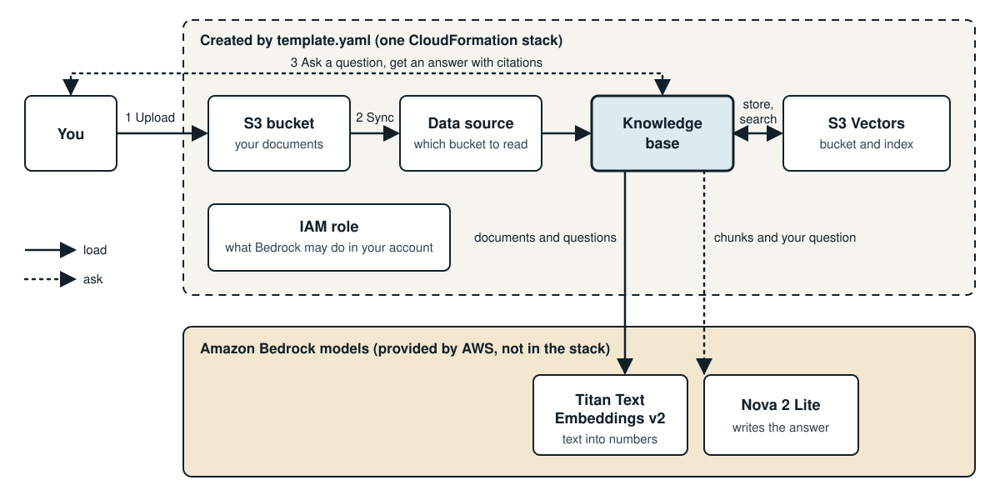

# Bedrock knowledge base starter

Build an AI assistant that answers questions from your own documents, using Amazon Bedrock and one CloudFormation template. You need no code and no tools on your laptop, only a browser and an AWS account.

Built for the TMU student AWS group session on 2026-11-19.

## Status

The template was tested from create to delete in `ca-central-1` on a paid AWS account on 2026-11-10. It has not been tested on a new free-plan account yet.

## Before you start: set a budget alert

The AWS free tier does not cover everything in this repo. Bedrock model calls are [charged by use](https://aws.amazon.com/bedrock/pricing/) and come out of your [account credits](https://docs.aws.amazon.com/awsaccountbilling/latest/aboutv2/free-tier-plans.html). Set a budget alert first.

1. Open **Billing and Cost Management** in the AWS console, and choose **Budgets**.
2. Choose **Create budget**, then **Use a template (simplified)**.
3. Choose **Monthly cost budget**. Enter an amount, such as $5, and your email address.
4. Choose **Create budget**.

An alert warns you. It does not stop spending, so finish with the [clean up](#clean-up) steps.

## What you build

A knowledge base cuts your documents into pieces called chunks. A model called Titan turns each chunk into a list of numbers called an embedding, and S3 Vectors stores them. When you ask a question, the knowledge base finds the chunks closest to your question, and a second model writes an answer from those chunks and cites them.

The sample documents describe the Quillon Bay Tinkerers' Guild, an invented club. No AI model can know its rules, so a correct answer has to come from your documents.

## Steps

Use one AWS Region for every step. These steps were tested in **Canada (Central) `ca-central-1`**.

### 1. Download this repo

On this GitHub page, choose **Code**, then **Download ZIP**, and unzip it.

### 2. Deploy the stack

1. Open **CloudFormation** in the AWS console.
2. Choose **Create stack**, then **With new resources (standard)**.
3. Choose **Upload a template file**, and select `template.yaml`.
4. Name the stack, for example `my-knowledge-base`, and choose **Next** until you reach the last page.
5. Tick the box that says CloudFormation might create IAM resources. The template creates one role, and the comments in `template.yaml` explain it.
6. Choose **Submit**, and wait for `CREATE_COMPLETE`.
7. Open the **Outputs** tab, and note `DocumentsBucketName`.

### 3. Upload the documents and sync

1. Open **S3**, and open the bucket from the Outputs tab.
2. Upload the five files from the `sample-data` folder. Do not upload anything from `workshop`, because it contains the answers.
3. Open **Amazon Bedrock**, choose **Knowledge bases**, and open the one named after your stack.
4. Select the data source, and choose **Sync**. Wait for it to finish.

### 4. Ask it questions

1. On the knowledge base page, choose **Test knowledge base**.
2. Turn on **Generate responses for your query**.
3. Choose **Select model**, pick **Nova 2 Lite**, and choose **Apply**.
4. Ask: *What is the name of the Guild's mascot?*
5. Select a footnote to see the text the answer came from.

Ask the same question in the Bedrock chat playground, with no knowledge base. Name the Guild in the question and compare the answers.

More questions and their expected answers are in [`workshop/test-questions.md`](workshop/test-questions.md). If answers look wrong or you see an error about an ongoing session, reload the page and start a new test session.

### 5. See how chunking changes an answer

1. In a new test session, ask: *What is the fire blanket called, and where is it?*
2. The name may be missing. Open the footnote, and read where the chunk ends.
3. Open `sample-data/workshop-rules.md`, and find the next sentence.
4. In a new test session, ask: *What do members call the fire blanket?*

The model only sees the chunks it gets back, so the way you ask decides what it can answer.

### 6. Try your own document

Upload a course outline or notes as a PDF, Word or text file. Do not upload private or personal information. Choose **Sync** again, then ask about it in a new test session.

## Clean up

Do this when you finish, so nothing keeps costing money.

1. Open **S3**, select your documents bucket, choose **Empty**, and confirm. CloudFormation cannot delete a bucket that still has files in it.
2. Open **CloudFormation**, select your stack, and choose **Delete**.
3. Wait until the stack is gone from the list.

## What is in this repo

- `template.yaml`: the stack, with a comment on each of its six resources.
- `sample-data/`: the five documents to upload.
- `workshop/test-questions.md`: questions and expected answers.

**Summary**
- You set a budget alert first.
- You deploy one CloudFormation template in the console.
- You upload five documents and press Sync.
- You ask questions and read the citations.
- You empty the bucket and delete the stack at the end.
